<div align="center">

<p align="center">
  
</p>

# 🔍 Awesome Visual Search & Discovery APIs 🚀

### *A Curated Directory of Enterprise SaaS Platforms & Open-Source Vision AI Retrieval Engines*

<p align="center">
  <a href="https://github.com/ishandutta2007/Awesome-Awesome-Awesome"></a><a href="https://discord.gg/jc4xtF58Ve"></a>
  <a href="https://github.com/ishandutta2007/Awesome-Visual-Search-Discovery-API/stargazers"></a>
  <a href="https://github.com/ishandutta2007/Awesome-Visual-Search-Discovery-API/network/members"></a>
  <a href="LICENSE"></a>
  <a href="https://github.com/ishandutta2007/Awesome-Visual-Search-Discovery-API/pulls"></a>
  <a href="https://github.com/ishandutta2007"></a>
</p>

<p align="center">
  <strong>Focus Areas:</strong> Multimodal CLIP Embeddings • E-Commerce Product Discovery • Reverse Image Search • Self-Hosted Vector Search • Zero-OCR Retrieval
</p>

---

</div>

## 📖 Table of Contents

- [🌟 Introduction & SEO Overview](#-introduction--seo-overview)
- [📊 Sector Overview & Market Dynamics](#-sector-overview--market-dynamics)
- [🏢 Enterprise SaaS & Hosted Platforms](#-enterprise-saas--hosted-platforms)
- [💻 Open-Source GitHub Projects](#-open-source-github-projects)
- [🧠 Technical Architecture: How Visual Search Works](#-technical-architecture-how-visual-search-works)
- [⚖️ Architectural Decision Matrix (SaaS vs. Self-Hosted)](#️-architectural-decision-matrix-saas-vs-self-hosted)
- [🎯 Real-World Use Cases](#-real-world-use-cases)
- [🤝 How to Contribute](#-how-to-contribute)
- [⭐ Star History](#-star-history)
- [📜 Disclaimer](#-disclaimer)

---

## 🌟 Introduction & SEO Overview

Visual Search & Discovery APIs empower end users to find information using images as first-class query inputs. Rather than guessing keywords or SKU strings, shoppers take or upload photos to locate matching products, detect exact duplicate visual assets, or discover semantically related items in real time.

Modern visual search platforms replace traditional keyword indexing with deep **computer vision** and **multimodal neural embeddings** (e.g., OpenAI CLIP, OpenCLIP, SigLIP, ColPali). These models project textual and visual representations into a unified vector embedding space where cosine similarity or Approximate Nearest Neighbor (ANN) indexing (HNSW, FAISS, Milvus, Qdrant) retrieves relevant visual records in under 100 milliseconds.

This repository tracks production-grade **commercial SaaS APIs** and **self-hostable open-source frameworks** designed for digital retailers, e-commerce platforms, marketplaces, digital asset managers (DAM), and industrial parts catalogs.

---

## 📊 Sector Overview & Market Dynamics

The global visual search market was valued between **$41.7 Billion and $51.5 Billion in 2024** and is projected to expand to **$151.6 Billion to $290.8 Billion by 2032–2033**, accelerating at a strong Compound Annual Growth Rate (CAGR) of **17.5% to 21.2%**, with visual commerce and automated product discovery representing the fastest-growing sector segments.

The sector exhibits **moderate fragmentation with dual-layer concentration**: horizontal hyperscale cloud providers (Google Cloud, Microsoft Azure, AWS) commoditize raw image recognition, OCR, and dense vector embeddings at scale, while specialized vertical providers (Syte, ViSenze, nyris) command high-margin retail and industrial accounts via domain-specific merchandising taxonomies, automated catalog enrichment, and "Shop the Look" workflows. Meanwhile, powerful open-source multi-modal engines (Marqo, Towhee, clip-retrieval) provide enterprise-grade self-hosting capabilities, preventing a complete winner-take-all monopoly and ensuring sustained innovation across open developer ecosystems.

---

## 🏢 Enterprise SaaS & Hosted Platforms

The following table provides commercial visual search and product discovery APIs. The table is sorted in **descending order by company size (valuation / revenue)**.

| SaaS Platform 🏷️ | Company Size (Valuation / Revenue) 📈 | Specific Starting Tier Pricing 💳 | Free Tier / Free Trial Limits 🎁 | Key Specialization & Capabilities 🚀 |
| :--- | :--- | :--- | :--- | :--- |
| **[Azure AI Vision](https://azure.microsoft.com/en-us/products/ai-services/ai-vision)** (Microsoft) | **~$3.12T Market Cap**<br>~$245B Annual Revenue *(Azure ~$75B+ ARR)* | **$1.00 – $1.50 per 1,000 transactions**<br>*(Standard S1 tier for dense multimodal image vectorization & embeddings)* | **5,000 transactions/month free forever**<br>*(Free F0 tier; rate limit capped at 20 calls/minute)* | Dense multimodal vector generation, spatial analysis, OCR, visual attribute detection, and native integration with Azure AI Search. |
| **[Google Cloud Vision Product Search](https://cloud.google.com/vision/product-search/docs)** (Alphabet) | **~$2.14T Market Cap**<br>~$307B Annual Revenue *(Google Cloud ~$36B+ ARR)* | **$4.50 per 1,000 query images**<br>*(Plus $0.10 per 1,000 reference images stored/month after free allowance)* | **1,000 prediction requests/month free forever**<br>*(Plus 1,000 reference images stored free/month & $300 90-day GCP trial credit)* | Managed visual product search indexing with automated bounding-box localization tailored for apparel, home goods, toys, and packaged goods. |
| **[Amazon Rekognition](https://aws.amazon.com/rekognition/)** (AWS) | **~$1.95T Market Cap**<br>~$575B Annual Revenue *(AWS ~$100B+ ARR)* | **$1.00 per 1,000 images analyzed**<br>*($0.001/image; Custom Labels model hosting starts at $4.00/hour)* | **1,000 images/month free for first 12 months**<br>*(Plus 1,000 face/user vectors stored free/month under AWS Free Tier)* | Visual similarity matching, custom model fine-tuning with Custom Labels, automated content moderation, and high-throughput serverless API scaling. |
| **[ViSenze Discovery Suite](https://www.visenze.com/)** (Rezolve AI) | **~$1.50B Market Cap** *(Rezolve AI)*<br>~$28.8M Standalone Valuation *(~$9M ARR)* | **~$299 / month**<br>*(Starter tier for SMB catalogs up to 10,000 SKUs via Shopify/API discovery suite)* | **30-day free trial**<br>*(Includes up to 10,000 test visual search queries and full access to catalog demo dashboard)* | E-commerce visual search specialist; automated item detection (dresses, shoes, bags), "Shop the Look", visual cross-selling, and mobile SDKs. |
| **[Syte](https://www.syte.ai/)** (Nayax) | **~$1.10B Market Cap** *(Nayax)*<br>~$150M Standalone Valuation *($71M raised; ~$15M ARR)* | **~$1,250 / month**<br>*(Entry Visual Discovery Suite tier for merchants handling up to 50,000 monthly sessions)* | **14-day interactive sandbox trial**<br>*(Pilot access with indexing support for up to 1,000 test catalog SKUs)* | AI retail discovery covering fashion, jewelry, home decor, and eyewear; visual taxonomy auto-tagging, shoppable lookbooks, and visual filters. |
| **[Clarifai](https://www.clarifai.com/)** | **~$500M Private Valuation**<br>~$100M+ Raised *(~$15M Annual Revenue)* | **$30 / month**<br>*(Essential Plan; provides 10,000 operations/month; Professional tier starts at $300/month)* | **1,000 operations/month free forever**<br>*(Community tier; 1 production application with access to pre-trained vision models)* | General-purpose computer vision platform, drag-and-drop workflow graphs, visual similarity search, gRPC/REST APIs, and custom model training. |
| **[TinEye Commercial API](https://tineye.com/products)** (Idée Inc.) | **~$40M Private Valuation**<br>Bootstrapped *(~$8M Annual Revenue)* | **$200 prepaid bundle for 5,000 searches**<br>*($0.04/search; credits valid for 2 full years; $300 for 10k searches)* | **Free API Sandbox environment**<br>*(Unlimited simulated/mocked API responses for integration testing; 0 production searches)* | Web-scale reverse image search engine; crawl footprint covering over 70 billion images for copyright monitoring, fraud detection, and duplicate discovery. |
| **[nyris](https://www.nyris.io/)** (nyris GmbH) | **~$25M Private Valuation**<br>~$15M Raised *(~$4M Annual Revenue)* | **€490 / month**<br>*(Starter tier for up to 5,000 industrial part queries with SLA-backed API access)* | **14-day guided proof-of-concept trial**<br>*(500 search queries limit with custom engineering support on sample catalogs)* | High-precision visual search engineered for industrial spare parts, CAD schematics, and equipment maintenance under challenging lighting and angles. |

---

## 💻 Open-Source GitHub Projects

The following list contains open-source repositories for self-hosted visual search, CLIP vector retrieval, and reverse image matching engines. The projects are sorted in **descending order by GitHub star count**.

- **[imagededup](https://github.com/idealo/imagededup)** [](https://github.com/idealo/imagededup/stargazers) — **The Python toolkit for near-duplicate and exact image deduplication.** Built by Idealo's tech team, `imagededup` simplifies finding duplicates and clustering visually identical media using both perceptual hashes (aHash, dHash, pHash, wHash) and convolutional neural network embeddings (MobileNet, VGG16, ResNet50). Ideal for cleaning product catalogs before indexing into visual search databases.
- **[Marqo](https://github.com/marqo-ai/marqo)** [](https://github.com/marqo-ai/marqo/stargazers) — **The open-source tensor search engine that unifies embedding generation and vector retrieval.** Apache-2.0 licensed. Marqo handles embedding generation, vector storage, and search in a single system. Supports multimodal search (image-to-image, text-to-image, image-to-text) out-of-the-box with Hugging Face and OpenCLIP backends. Run easily via Docker: `docker run --name marqo -it --privileged -p 8882:8882 marqoai/marqo`.
- **[Towhee](https://github.com/towhee-io/towhee)** [](https://github.com/towhee-io/towhee/stargazers) — **Production pipelining framework dedicated to neural data processing and visual embeddings.** Towhee provides pre-built, production-ready operators for image and video feature extraction, CLIP encoding, and direct integration with vector search engines like Milvus, FAISS, and Qdrant.
- **[clip-retrieval](https://github.com/rom1504/clip-retrieval)** [](https://github.com/rom1504/clip-retrieval/stargazers) — **Extreme-scale CLIP image retrieval system.** Developed by LAION contributor Romain Beaumont, `clip-retrieval` easily computes CLIP embeddings for millions or billions of images and serves them via an interactive web UI or fast Python backend powered by Autofaiss and HNSW. Powers discovery on the 5-billion-image LAION-5B dataset.
- **[Milvus Bootcamp](https://github.com/milvus-io/bootcamp)** [](https://github.com/milvus-io/bootcamp/stargazers) — **Production reference blueprints for reverse image search and unstructured data similarity.** Contains step-by-step tutorials, Docker Compose recipes, and production architectures pairing PyTorch/Towhee vision models with the Milvus distributed vector database to serve reverse image search over billions of items.
- **[ColiVara](https://github.com/tjmlabs/ColiVara)** [](https://github.com/tjmlabs/ColiVara/stargazers) — **Zero-OCR visual document and image retrieval suite.** Uses vision-language models (such as ColPali) to index and retrieve visual documents, schematics, and catalog pages directly based on visual embeddings without relying on fragile OCR or text chunking pipelines.
- **[Match](https://github.com/dsys/match)** [](https://github.com/dsys/match/stargazers) — **Scalable, production-ready reverse image search built on Kubernetes and Elasticsearch.** Employs pre-trained convolutional neural networks to extract feature vectors and leverages Elasticsearch's vector search plugins for horizontally scalable approximate nearest neighbor matching.
- **[PicImageSearch](https://github.com/kitUIN/PicImageSearch)** [](https://github.com/kitUIN/PicImageSearch/stargazers) — **Asynchronous reverse image search aggregation client in Python.** Provides unified async API access to major commercial reverse image search engines, including Google Lens, SauceNAO, Ascii2D, Yandex, Baidu, and e-Hentai with proxy and throttling support.
- **[V* (V-Star)](https://github.com/penghao-wu/vstar)** [](https://github.com/penghao-wu/vstar/stargazers) — **Guided visual search as a core mechanism in Multimodal LLMs.** Official PyTorch implementation of the visual search mechanism that allows vision-language agents to zoom in, locate fine-grained details, and answer visual discovery questions over high-resolution imagery.
- **[visual_search](https://github.com/tuan3w/visual_search)** [](https://github.com/tuan3w/visual_search/stargazers) — **Visual search engine based on Elasticsearch and TensorFlow.** An educational, clean implementation pairing TensorFlow CNN feature extraction with Elasticsearch k-NN search and a Flask web interface for catalog matching.
- **[ImgSearch](https://github.com/seamile/ImgSearch)** [](https://github.com/seamile/ImgSearch/stargazers) — **The lightweight reverse image search engine running on 2GB RAM.** Based on TinyCLIP and HNSWlib, `ImgSearch` supports search-by-image and text-to-image queries with negligible hardware requirements, making it ideal for edge devices and low-cost VPS instances.
- **[VisualMatch](https://github.com/arianshomakher-pixel/VisualMatch)** [](https://github.com/arianshomakher-pixel/VisualMatch/stargazers) — **AI-powered visual product search engine for e-commerce with social DM integration.** Leverages OpenAI CLIP (`openai/clip-vit-base-patch32`) to generate 512-dimensional embeddings and delivers sub-100ms similarity lookups alongside an Instagram DM bot integration for conversational visual shopping.
- **[OmniSearch](https://github.com/Argarm/OmniSearch)** [](https://github.com/Argarm/OmniSearch/stargazers) — **Semantic and visual product discovery microservice.** Built with FastAPI, Hugging Face CLIP, and Sentence-BERT, connecting to Qdrant or Milvus vector databases to offer combined text-and-image search for catalog items.

---

## 🧠 Technical Architecture: How Visual Search Works

A standard visual search pipeline consists of four decoupled layers:

```
┌─────────────────┐       ┌────────────────────────┐       ┌───────────────────────┐
│  Query Image    │ ----> │ Embedding Generation   │ ----> │ Vector Index (ANN)    │
│  (Camera/Upload)│       │ (CLIP / OpenCLIP / VLM)│       │ (HNSW / FAISS / Qdrant)│
└─────────────────┘       └────────────────────────┘       └───────────┬───────────┘
                                                                       │ Top-K Matches
                                                                       ▼
                                                           ┌───────────────────────┐
                                                           │ Merchandising / Filter│
                                                           │ (Category, Price, In) │
                                                           └───────────────────────┘
```

1. **Preprocessing & Object Detection**: The system identifies regions of interest (e.g., separating a handbag from the model holding it) using YOLO or specialized bounding-box detectors.
2. **Dense Vector Embedding**: Vision transformers (ViT-B/32, ViT-L/14) encode visual attributes (color, texture, contour, pattern) into continuous dense vector representations (typically 512 to 1024 dimensions).
3. **Approximate Nearest Neighbor (ANN) Search**: Vector databases index embeddings using Hierarchical Navigable Small World (HNSW) or Inverted File with Product Quantization (IVF-PQ) graphs to calculate cosine similarity within milliseconds.
4. **Business Logic & Merchandising Rules**: Results are re-ranked using inventory availability, brand exclusions, margin rules, and user click-through rate (CTR) signals.

---

## ⚖️ Architectural Decision Matrix (SaaS vs. Self-Hosted)

| Evaluation Metric 📐 | Enterprise SaaS Platforms (Google, Syte, ViSenze) | Self-Hosted Open-Source (Marqo, Towhee, Milvus) |
| :--- | :--- | :--- |
| **Setup Velocity** | ⚡ Turnkey: integrate via REST API / JS SDK in 1–3 days | 🛠️ Moderate: requires Docker/K8s cluster and GPU orchestration |
| **Catalog Auto-Tagging** | ✅ Automated taxonomies (detects sleeve length, pattern, material) | ⚠️ Manual: requires fine-tuning auxiliary multi-label classifiers |
| **Cost at Low Volume (<50k queries/mo)** | 💰 Low ($0 to ~$30/month via free/starter tiers) | 💸 Higher baseline (requires persistent cloud instance/GPU) |
| **Cost at High Volume (>5M queries/mo)** | 💸 Expensive ($5,000 to $20,000+/month in API consumption) | 💰 Highly economical (fixed server cost, near-zero per-query fee) |
| **Data Privacy & Air-Gap** | ❌ Data traverses third-party vendor clouds | ✅ 100% private: runs entirely inside your VPC or on-prem servers |
| **Subtle Variation Recall** | 🎯 Optimized specifically for retail merchandising | 🔍 Depends on choice of foundation model (CLIP vs. SigLIP) |

---

## 🎯 Real-World Use Cases

- **🛍️ Fashion & Retail Discovery**: Allowing shoppers to upload Instagram screenshots or camera photos to immediately find identical or visually similar clothing items ("Shop the Look").
- **🔩 Industrial Maintenance & Spare Parts Identification**: Enabling field technicians to photograph worn-out machine components, screws, gears, or pipes and immediately fetch OEM part numbers (powered by solutions like nyris).
- **🛡️ Copyright Protection & Brand Infringement Monitoring**: Scanning marketplaces and social networks for unauthorized visual reproductions or counterfeit goods (powered by engines like TinEye and imagededup).
- **📑 Zero-OCR Visual Document Search**: Retrieving financial contracts, engineering blue-prints, and multi-column tables directly via visual embeddings (powered by ColiVara).

---

## 🤝 How to Contribute

Contributions are enthusiastically welcomed!

1. **Fork the repository** to your GitHub account.
2. **Add or update an entry** in `README.md` following the established table or markdown format.
3. **Ensure strict data criteria**:
   - For SaaS: include specific starting prices, specific free tier limits, and company size data.
   - For Open-Source: verify the project is actively maintained and add the standard star badge linking to `/stargazers`.
4. **Submit a Pull Request** with a concise description of the addition.

---

##  Star History

[](https://star-history.dera.page/#ishandutta2007/Awesome-Visual-Search-Discovery-API&type=date&legend=top-left)

---

## 📜 Disclaimer

- This is an independent, community-curated repository and does not represent an endorsement or official affiliation with any listed vendor.
- Visual search quality heavily depends on chosen embedding models, catalog size, and inference latency requirements. Always run a pilot proof-of-concept against your catalog data before choosing an architecture.
- All product names, trademarks, and registered trademarks belong to their respective owners.

<div align="center">
  <sub>Maintained with ❤️ by the open-source community for AI engineers and e-commerce technologists.</sub>
</div>
